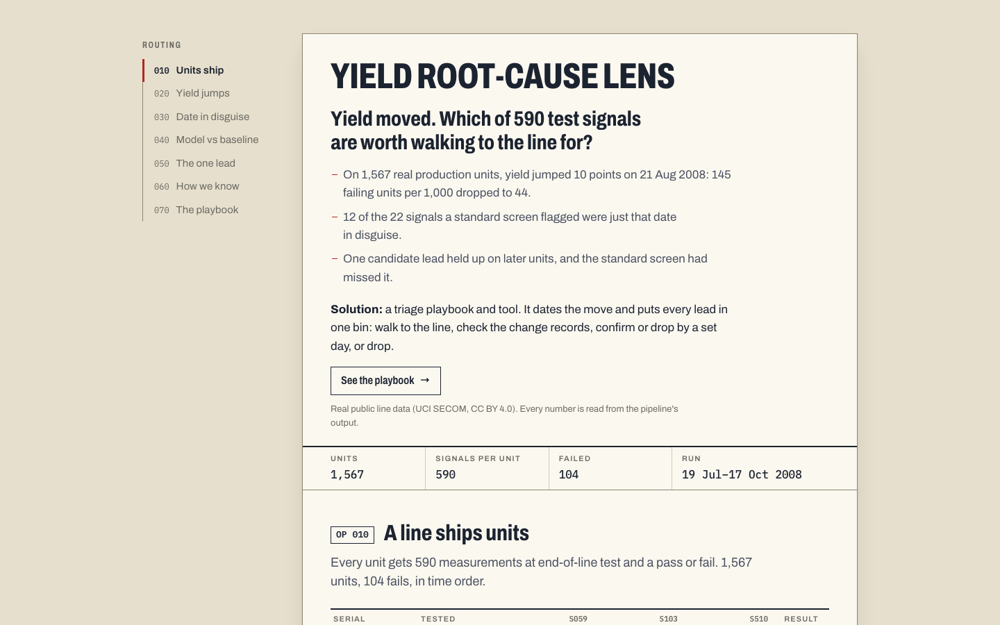
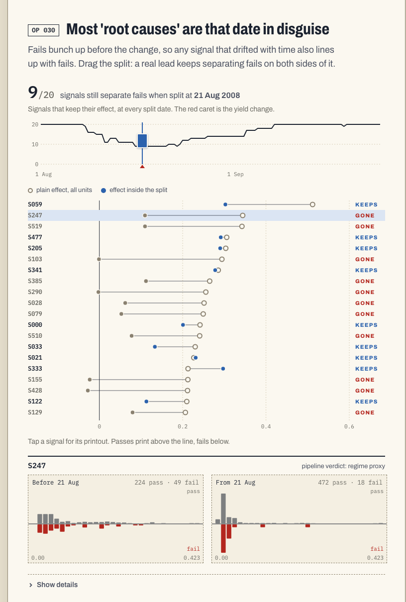
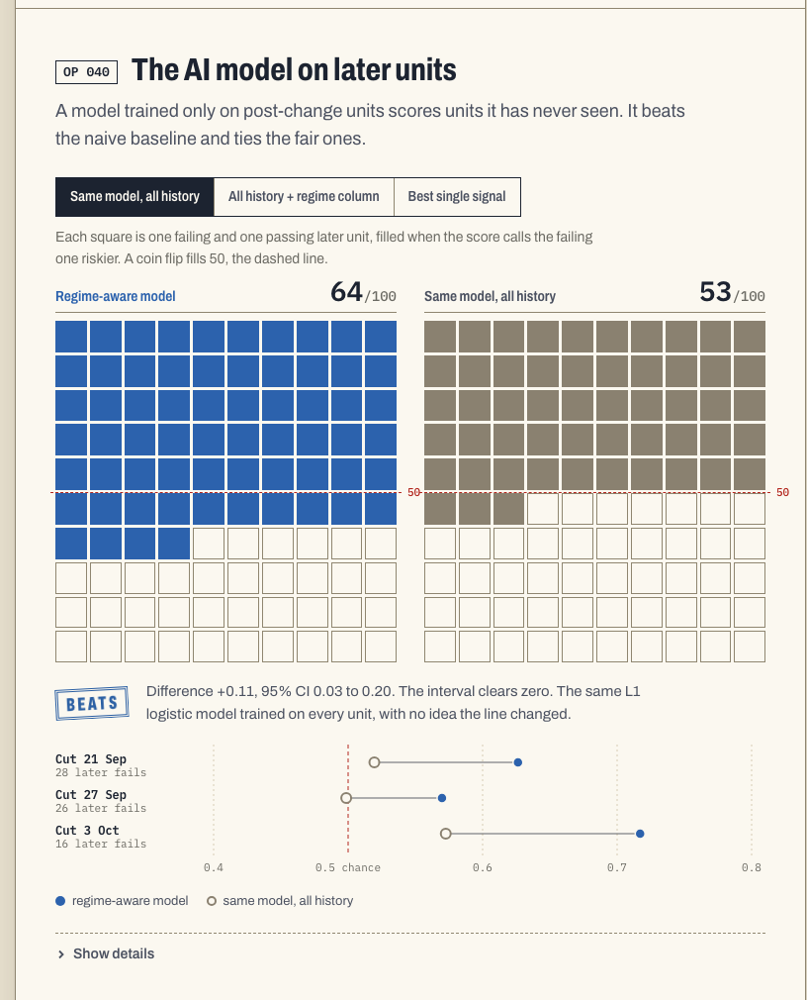
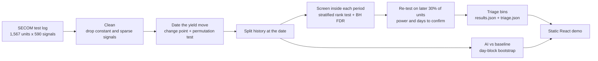

# Yield Root-Cause Lens

**When a line's yield moves, find the date it moved and sort every lead into what to check first.**

[](tests/)
[](LICENSE)
[](https://doi.org/10.24432/C54305)
[](requirements.txt)
[](package.json)

[](https://ibiraheel.com/demos/yield-root-cause-lens/)

**[Live demo](https://ibiraheel.com/demos/yield-root-cause-lens/)** · [METHOD.md](METHOD.md) · [SOLUTION.md](SOLUTION.md)

---

### The question
When a line's yield moves, which of hundreds of test signals are worth walking to the line for, and which are just the
date the process changed, in disguise?

### The answer
On 1,567 real production units with 590 test signals each, yield jumped 10.1 points on 21 Aug 2008: from 145 failing
units per 1,000 to 44. A standard screen flagged 22 signals, and 12 of them were tracking that date, not failures.
Comparing fails with passes *inside* each production period removed them and found one candidate lead that held up on
later units, a lead the standard screen had missed.

### The solution
A one-page lead-triage playbook ([SOLUTION.md](SOLUTION.md)) and a small tool, `npm run triage`. Give it a line's test
log and it returns the change date and puts every lead in one bin: **walk to the line**, **check the change records**,
**confirm or drop by day N**, or **drop**.

---

## Key results

Every number below is read from `public/results.json` or [METHOD.md](METHOD.md).

| What | Result |
|---|---|
| Data | 1,567 units, 590 signals (444 kept after cleaning), 104 fails, 19 Jul to 17 Oct 2008 |
| Yield change | 85.5% → 95.6% on 21 Aug 2008; +10.1 points (95% CI 6.4 to 14.1), permutation p = 0.001 |
| Standard (pooled) screen | 22 leads at BH q < 0.05 |
| Of those, tracking the date | 12 regime proxies with no effect inside either period |
| Within-period screen | 9 leads; 1 (S336) also holds on the later 30% of units: δ = 0.25 (95% CI 0.02 to 0.48), one-sided p = 0.018 |
| Honest label on S336 | Candidate, not confirmed: BH across the nine re-tested leads gives q = 0.16 |
| Confirm-or-drop dates | 6 open leads need 22 to 63 days of production each |
| Smallest effect the test window can see | δ = 0.29 at 80% power with 26 later fails; 16 of the 22 pooled leads sit below it |
| Why the within-period test | On 500 simulated lines where a signal only trends with time: pooled test 94.8% false positives, stratified 4.4% |

<p align="center"></p>

## AI vs baseline

Three trained models, each scored against a simple baseline on held-out time (validation split by whole days, day-block
bootstrap 95% CIs on the difference).

| Trained model | Baseline | Result | Verdict |
|---|---|---|---|
| Regime-aware failure model (L1 logistic, post-change units only) | Same model trained on all history | ROC-AUC 0.64 vs 0.53, +0.11 (CI 0.03 to 0.20) | **Win** |
| Regime-aware failure model | All-history model plus a regime column | +0.06 (CI −0.02 to 0.11) | **Tie** |
| Regime-aware failure model | Best single within-period signal | +0.06 (CI −0.03 to 0.18) | **Tie** |
| Stability-selection root-cause ranker | Plain Welch t ranking | Top-10 held-out δ 0.016 vs 0.072, −0.056 (CI −0.13 to 0.01) | **Loss** |
| Isolation Forest change detector | Bernoulli CUSUM at the same false-alarm rate | First alarm 15 Oct, 1,177 units after the change; the CUSUM alarms two weeks early | **Loss** (neither detects the step) |

Knowing the regime is what matters. No trained model here clearly beats a simple baseline that also knows it. The
fairer regime-column check was added at review, after the main result was known. Details in [METHOD.md](METHOD.md).

<p align="center"></p>

## How it works



- `pipeline/yrcl/stats.py`: U statistic, Cliff's delta, Benjamini-Hochberg, CUSUM and the change point, each written
  out and unit-tested against hand calculations and SciPy.
- `pipeline/yrcl/rootcause.py`: per-signal change points, the regime-stratified screen, power and sample size, and
  `classify_lead`, the one rule that both the pipeline and the triage tool use.
- `pipeline/yrcl/ai.py`: stability selection, the regime-aware model, Isolation Forest and Bernoulli CUSUMs with matched
  run lengths, and the day-block bootstrap.
- The demo reads the precomputed JSON. It has no backend and needs no API keys.

## Quickstart

```bash
# 1. Data (CC BY 4.0), kept outside the repo
mkdir -p ../_downloads/secom
curl -L -o ../_downloads/secom/secom.zip https://archive.ics.uci.edu/static/public/179/secom.zip
unzip -o ../_downloads/secom/secom.zip -d ../_downloads/secom

# 2. Python environment
python3 -m venv .venv && .venv/bin/pip install -r requirements.txt

# 3. Pipeline, tests, tool
npm run pipeline     # writes public/results.json (about 3.5 min)
npm run test:py      # 44 tests
npm run triage       # lead sheet for SECOM, writes triage.json

# 4. Demo
npm install
npm run dev          # http://localhost:5173/demos/yield-root-cause-lens/
npm run build        # static site in dist/, built for the /demos/yield-root-cause-lens/ path
```

To run the tool on your own line, export one row per unit with `ts`, `fail` (1 or 0) and one numeric column per signal:

```bash
.venv/bin/python -I pipeline/triage.py --csv line_log.csv --split 0.7 --out triage.json
```

## Repo layout

```
pipeline/
  run_pipeline.py     cleaning, pooled screen, models
  run_rootcause.py    change points, within-period screen, power
  run_ai.py           AI vs baseline comparisons
  triage.py           lead-triage CLI
  yrcl/               stats, rootcause, ai, load
tests/                44 pytest checks
src/                  Vite + React demo
public/results.json   precomputed results the demo reads
METHOD.md             equations, assumptions, validation table
SOLUTION.md           the playbook and decision rules
```

[METHOD.md](METHOD.md) has the equations, assumptions, the validation table (hand calculations, SciPy cross-checks,
published CUSUM run lengths, planted-step recovery, Monte Carlo power) and the full limitations.
[SOLUTION.md](SOLUTION.md) has the playbook, the bin rules and the week-1 plan.

## Data

McCann, M. & Johnston, A. (2008). *SECOM* [Dataset]. UCI Machine Learning Repository.
https://doi.org/10.24432/C54305. Licensed under [CC BY 4.0](https://creativecommons.org/licenses/by/4.0/).

1,567 units from a semiconductor line, 590 anonymised measurements, pass/fail labels and timestamps. Here it stands in
for an assembly line's end-of-line test logs. The analysis uses no synthetic data; simulated series appear only in the
validation tests.

## Limitations

- **One line, one change.** SECOM covers three months of one process. The playbook's thresholds are conventions or read
  from this data, and need checking on another line.
- **Few fails.** The later test window holds 26 fails, so many failed re-tests are untestable rather than disproved.
- **Anonymised signals.** Signals are numbered, so no lead can be traced to a physical station or checked against real
  change records.
- **The trained models do not clearly earn their place.** The regime-aware model beats a naive baseline but ties every
  baseline that also knows the regime.
- **Confirm-or-drop dates are optimistic.** They assume each lead's training effect is real, and effects of selected
  leads run high.

## Author

**Ibi Raheel** · mechanical engineer building AI tools · [ibiraheel.com](https://ibiraheel.com)

Code under the [MIT licence](LICENSE). Data under CC BY 4.0, credited above.
